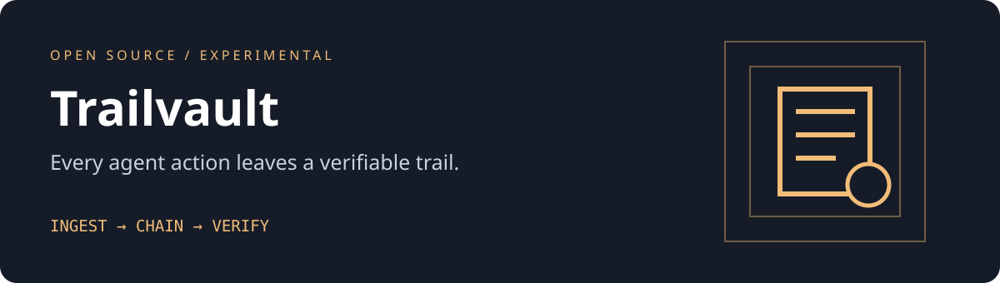

# Trailvault

A single-binary, self-hosted audit journal for agent actions.

 



Trailvault records small structured action events in a synced append-only JSONL journal. Every event carries the previous event's SHA-256 hash. The service embeds a small admin UI and has no runtime dependencies. A hash chain is tamper-evident relative to a trusted head, **not tamper-proof**: someone controlling the file can rewrite the entire chain or truncate its tail.


## Features

- Bearer-token authenticated ingest, listing and verification APIs
- Embedded admin UI with append, pagination and chain inspection
- Per-event fsync and startup integrity checks
- Cursor pagination and actor filtering
- One executable, standard-library Go, no external database
- Non-root container and loopback-only defaults

## 10-minute quickstart

Go 1.23+ and Python 3 (only used below to generate a local token). No cloud account needed.

```sh
# 0-2 min: test and build
go test ./...
go build -o trailvault .
# 2-3 min: configure and run
export TRAIL_TOKEN=$(python3 -c 'import secrets; print(secrets.token_hex(24))')
./trailvault
```

At minutes 3-5, open http://127.0.0.1:8080 and paste the token from your terminal into the token field. The token stays in tab memory, not local storage. At minutes 5-7, record an action in the form, load the journal and verify the chain. At minutes 7-10, try the API from another terminal (export the same token there):

```sh
curl -s http://127.0.0.1:8080/api/events \
 -H "Authorization: Bearer $TRAIL_TOKEN" \
 -H 'Content-Type: application/json' \
 -d '{"actor":"demo-agent","action":"document.read","outcome":"ok","details":"Read a public specification"}'
curl -s -H "Authorization: Bearer $TRAIL_TOKEN" http://127.0.0.1:8080/api/verify
```

### One-command container deployment

With Docker Compose installed and `TRAIL_TOKEN` exported:

```sh
docker compose up --build -d
```

The named volume preserves the journal. This container recipe is supplied but was not executed in the build environment; the native Go service was built and tested. See [VALIDATION.md](VALIDATION.md).

## API

| Method | Path | Behavior |
| --- | --- | --- |
| POST | `/api/events` | Append one event; requires actor, action, outcome; optional details |
| GET | `/api/events?after=0&actor=demo-agent` | Up to 100 events after a sequence number; actor filter optional |
| GET | `/api/verify` | In-memory count and chain head; journal was verified from disk at startup |

Outcomes: `ok`, `blocked`, `failed`. Unknown fields, oversized bodies and malformed JSON are rejected. All API routes require `Authorization: Bearer TOKEN`. There is no delete endpoint.

## Architecture

```text
HTTP / embedded UI -> token check -> input validation -> mutex
                                                      -> JSONL append + fsync
                                                      -> in-memory event index
```

`TRAIL_TOKEN` is required (24+ characters). `TRAIL_ADDR` defaults to `127.0.0.1:8080`; `TRAIL_DATA` defaults to `data/events.jsonl`. The journal is created mode 0600. Keep it out of version control. No third-party code or artwork is bundled.

## Operating limits and threat model

Run only one process per journal file; there is no interprocess lock. All events live in memory. No TLS, multi-user auth, roles, rate limiter, retention, automatic recovery or external anchoring is provided. Put it behind a TLS reverse proxy and access controls before remote use. A bearer-token holder can forge an actor name. Do not log prompts, credentials or sensitive content. Back up the journal and pin a trusted head externally to detect tail truncation or a rewritten chain. A disk write failure puts the store into fail-closed state until restart; inspect partial writes manually. API verify does not continuously re-read the disk. Hashes use encoding/json over the Event struct with an empty hash field; field order is part of this v0.1 format. Verification rehashes the whole chain under the append mutex, so it pauses writes and is not a high-volume endpoint. No claim of production readiness.

## Roadmap

- External head anchoring and export verification CLI
- Bounded embedded database, retention and per-client tokens
- Crash-injection tests and operating guide for recovery

## Inspiration

[Small self-contained servers](https://github.com/pocketbase/pocketbase) inspired the deploy shape, not its database or authentication internals. Trailvault is original Go code with embedded JSONL storage rather than a PocketBase clone.

## Contributing

Read [CONTRIBUTING.md](CONTRIBUTING.md). Code and original artwork are [MIT licensed](LICENSE).
